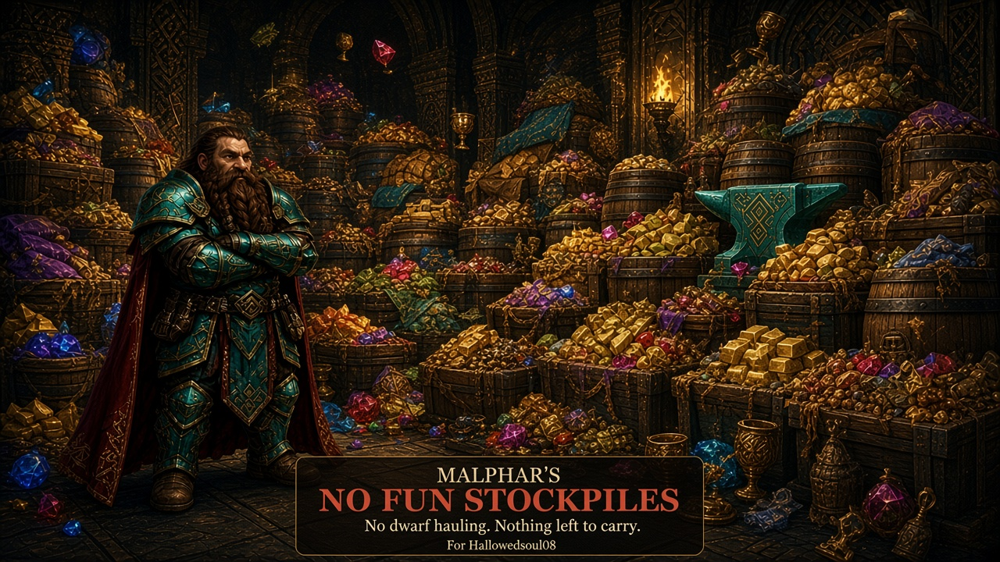

# Malphar's No Fun Stockpiles

For Hallowedsoul08.

This was an exercise in whether hauling had to exist, not whether it should.

> For when you don't want to have any fun carrying things.
>
> The bins are already full. The barrels are already full. There is nothing left to carry.

| | |
|---|---|
| Game | Steam Dwarf Fortress |
| Requires | [DFHack](https://github.com/DFHack/dfhack) |
| Version | 1.0.0 |
| Dedicated to | Hallowedsoul08 |
| Source | [AlanCalhoun/games](https://github.com/AlanCalhoun/games/tree/main/Dwarf%20Fortress/malphars-no-fun-stockpiles) |

## Install

1. Install Dwarf Fortress from Steam, with DFHack.
2. Copy this folder to `%APPDATA%\Bay 12 Games\Dwarf Fortress\mods\malphars_nofun_stockpiles`.
3. Enable **Malphar's No Fun Stockpiles**.
4. Do not also enable **Malphar's No Fun Cheat Mod**. That mod already does this, and both at once will fight over the same piles.

The script starts when the fort loads. You do not type commands. An old fort is fine. This does not change world generation.

## What it does

**Stockpile.** Every stockpile shares one inventory. Goods teleport into infinite bins and barrels — dwarves do not haul stockpile jobs. Floors stay clear; dropped and forbidden items are unforbidden and pulled into the nearest pile. Workshop clutter is cleared. Extra logs above ~100 are discarded after cutting, but trees you mark still get felled.

Furniture and build materials stay on the tile while you are placing a building, or while a construct job exists, so doors and beds are not vacuumed out from under the designation.

## Scripts

| Script | Role |
|---|---|
| `malphar-nofun-stockpiles` | Shared piles, teleport stock, infinite containers, no haul, wood cap |

`disable malphar-nofun-stockpiles` turns it off until the fort loads again.

## Limits

- This is only the stockpile cheat. No god-mode dwarves, no workshop, no aquifers, no squad gear.
- A door still has to sit in a gap next to a wall. This mod will not place it for you.
- Hidden stones from other mods still block the tile.
- If the fort stutters, the shared pile is the cause.
